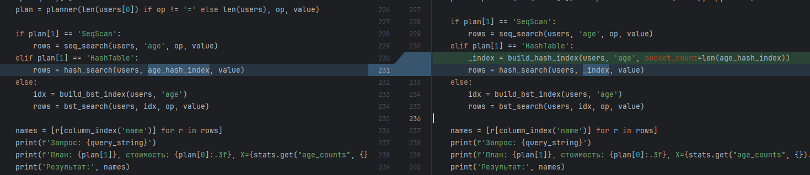

# Лаба 1

## Обращение 1

```python
reset_scenario(add_new=True)
print('Число записей в таблице:', len(users))
run_query('select name from users where age = 18')
```

Планировщик выбирает HashTable. 
В случае ветки HashTable, система использует уже сделанный хэш-индекс. 
В коде хэш индекс составляется один раз

Решением является создание хэш индекса в ветке HashTable по аналогии с BST.

На картинке изображён `git diff`



### Исправленные условия

```python
    if plan[1] == 'SeqScan':
        rows = seq_search(users, 'age', op, value)
    elif plan[1] == 'HashTable':
        _index = build_hash_index(users, 'age', bucket_count=len(age_hash_index))
        rows = hash_search(users, _index, value)
    else:
        idx = build_bst_index(users, 'age')
        rows = bst_search(users, idx, op, value)
```
