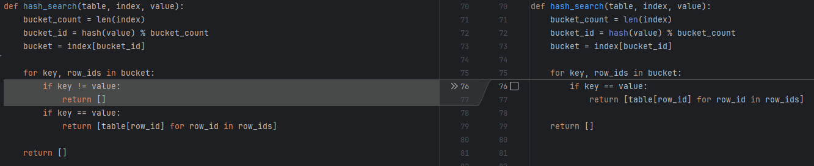

# Лаба 1

## Обращение 1

```python
reset_scenario(add_new=True)
print('Число записей в таблице:', len(users))
run_query('select name from users where age = 18')
```

Планировщик выбирает HashTable. 
В случае ветки HashTable, система использует уже сделанный хэш-индекс. 
В коде хэш индекс составляется один раз

Решением является создание хэш индекса в ветке HashTable по аналогии с BST.

На картинке изображён `git diff`


### Исправленные условия

```python
    if plan[1] == 'SeqScan':
        rows = seq_search(users, 'age', op, value)
    elif plan[1] == 'HashTable':
        _index = build_hash_index(users, 'age', bucket_count=len(age_hash_index))
        rows = hash_search(users, _index, value)
    else:
        idx = build_bst_index(users, 'age')
        rows = bst_search(users, idx, op, value)
```

---

## Обращение 2

```python
reset_scenario(add_new=True)
run_query('select name from users where age = 30')
```

Планировщик выбирает HashTable.
Текущая проблема заключается в том что значения, которые попадают в корзину не проверяются до конца.

Функция hash_search не до конца проверяет стакан. 
Поэтому решением было убрать условие досрочного выхода.



### Исправленные условия

```python
def hash_search(table, index, value):
    bucket_count = len(index)
    bucket_id = hash(value) % bucket_count
    bucket = index[bucket_id]

    for key, row_ids in bucket:
        if key == value:
            return [table[row_id] for row_id in row_ids]

    return []
```
