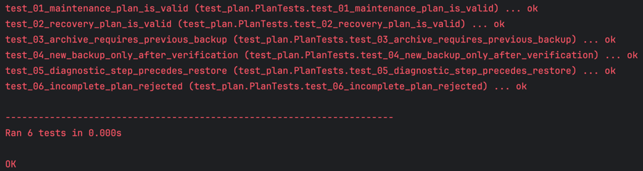
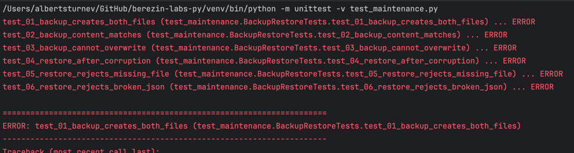

# ЛР 3

---

Исходное состояние:
```
OK {'users': 6, 'tickets': 20, 'archive': 0, 'total': 20}
```

Пользователей - 6
Обращений - 20
Архивировано - 0
Всего - 20

---

## Задание 1

При запуске "python plan_runner.py --check", программа выдала ожидаемый порядок в MAINTENANCE_PLAN

```
[FAIL] Сначала проверка, затем B0, архивирование, повторная проверка, затем B1
```

Порядок исправлен следующим образом:

```python
MAINTENANCE_PLAN = [
    "CHECK",
    "BACKUP_B0",
    "ARCHIVE",
    "CHECK",
    "BACKUP_B1",
]
```

После запуска с обновленным планом программа выдала другой результат.

```
[PASS] План обслуживания: верный порядок
[FAIL] Сначала диагностируйте сбой, затем восстанавливайте B1, затем проверяйте
```

В нём сказано, что план MAINTENANCE прошел валидацию. А порядок RECOVERY - нет.

План был изменен согласно выводу программы.

```
RECOVERY_PLAN = [
    "DIAGNOSE",
    "RESTORE_B1",
    "CHECK",
]
```

Проверка скриптом plan_runner прошла успешно.

```
[PASS] План обслуживания: верный порядок
[PASS] План восстановления: верный порядок
Планы проверены. Файлы не изменялись.
```

Все тесты прошли. Пройденные тесты изображены на рисунке 1.



---

## Задание 2

При запуске тестов для maintenance.py выводятся ошибки для всех случаев.
На рисунке 2 изображен вывод.



Задание заключается в написании реализации для функций "create_backup" и "restore_backup".

Для оценки правильности написания будут использоваться тесты.

Для проверки имплементации "create_backup":

```bash
python -m unittest -v test_maintenance.py -k backup
```

Для проверки имплементации "restore_backup":
```bash
python -m unittest -v test_maintenance.py -k restore
```

Написанная реализация для функции "create_backup":

```python
def create_backup(data_dir, backup_dir):
    data_dir = Path(data_dir)
    backup_dir = Path(backup_dir)

    backup_dir.mkdir(parents=True, exist_ok=False)

    try:
        for data_file in DATA_FILES:
            if not data_dir.exists():
                raise Exception(f"data_dir: {data_dir} must exist")

            p_data_file = data_dir / data_file
            p_backup_file = backup_dir / data_file
            shutil.copy2(p_data_file, p_backup_file)

            p_backup_file.write_bytes(p_data_file.read_bytes())
    except:
        shutil.rmtree(backup_dir)
        raise

    return backup_dir
```

Тесты "backup" проходят успешно. Вывод тестов:

```
test_01_backup_creates_both_files (test_maintenance.BackupRestoreTests.test_01_backup_creates_both_files) ... ok
test_02_backup_content_matches (test_maintenance.BackupRestoreTests.test_02_backup_content_matches) ... ok
test_03_backup_cannot_overwrite (test_maintenance.BackupRestoreTests.test_03_backup_cannot_overwrite) ... ok

----------------------------------------------------------------------
Ran 3 tests in 0.008s

OK
```

Написанная реализация для функции "restore_backup"

```python
def restore_backup(backup_dir, data_dir):
    from checks import inspect_system

    backup_dir = Path(backup_dir)
    data_dir = Path(data_dir)

    # Для прохождения test_06_restore_rejects_broken_json
    if not inspect_system(backup_dir)["ok"]:
        raise ValueError("System not ok")

    data_dir.mkdir(parents=True, exist_ok=True)

    for filename in DATA_FILES:
        p_backup = backup_dir / filename
        p_data = data_dir / filename
        shutil.copy2(p_backup, p_data)

    return data_dir
```

Тесты "restore" проходят успешно. Вывод тестов:

```
test_04_restore_after_corruption (test_maintenance.BackupRestoreTests.test_04_restore_after_corruption) ... ok
test_05_restore_rejects_missing_file (test_maintenance.BackupRestoreTests.test_05_restore_rejects_missing_file) ... ok
test_06_restore_rejects_broken_json (test_maintenance.BackupRestoreTests.test_06_restore_rejects_broken_json) ... ok

----------------------------------------------------------------------
Ran 3 tests in 0.007s

OK
```

Все тесты "maintenance" проходят успешно. Вывод тестов:

```
test_01_backup_creates_both_files (test_maintenance.BackupRestoreTests.test_01_backup_creates_both_files) ... ok
test_02_backup_content_matches (test_maintenance.BackupRestoreTests.test_02_backup_content_matches) ... ok
test_03_backup_cannot_overwrite (test_maintenance.BackupRestoreTests.test_03_backup_cannot_overwrite) ... ok
test_04_restore_after_corruption (test_maintenance.BackupRestoreTests.test_04_restore_after_corruption) ... ok
test_05_restore_rejects_missing_file (test_maintenance.BackupRestoreTests.test_05_restore_rejects_missing_file) ... ok
test_06_restore_rejects_broken_json (test_maintenance.BackupRestoreTests.test_06_restore_rejects_broken_json) ... ok

----------------------------------------------------------------------
Ran 6 tests in 0.015s

OK
```

---


